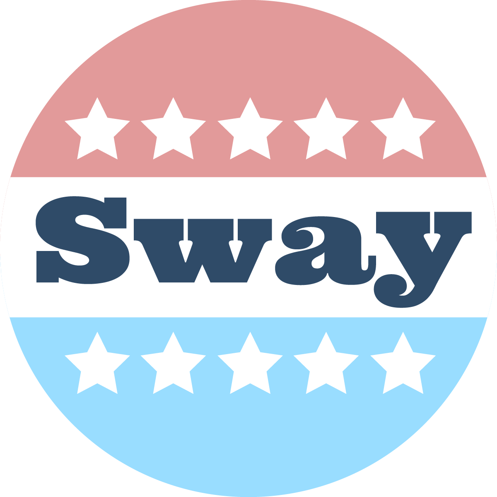
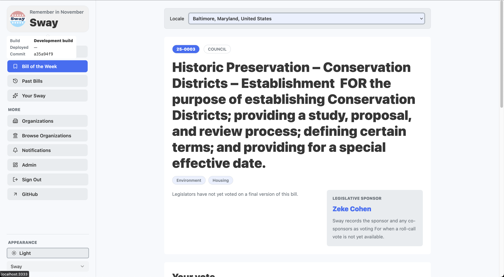
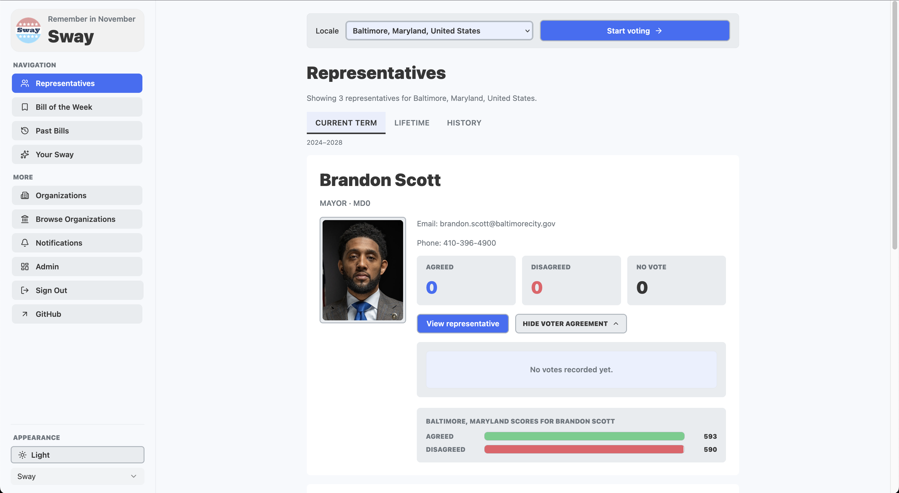

[](https://twitter.com/Sway_Vote)
[](https://patreon.com/sway_vote)
[](https://www.gnu.org/licenses/agpl-3.0.en.html)

<p align="center" width="100%">
    
</p>

Remember in November - [https://sway.vote](https://sway.vote)

<p align="center" width="100%">
    
    
</p>

## What is Sway

Sway is a platform for engaging in the democratic process. With Sway, you can directly influence your elected representatives by voting on the same legislation that they do.

Sway was created to solve two problems of democracy:

1. Years can pass between elections that decide who will represent you.

2. Keeping track of how well your representatives have represented you can be difficult.

Because of these difficulties, it can be challenging to hold elected representatives accountable for their actions.

## How Sway Is Built

Sway is a Ruby on Rails application with a React front end, joined by [Inertia.js](https://inertia-rails.dev) — Rails controllers pass props directly to React pages, with no separate JSON API or client-side router. Data lives in SQLite. Users sign in with passkeys (WebAuthn) after a one-time SMS verification, and vote tallies sync in real time over ActionCable. Production runs on [Kamal](https://kamal-deploy.org) with Docker.

The repository also contains:

- [`mobile/`](/mobile) — an [Expo](https://expo.dev) React Native app for iOS and Android that consumes the same backend.
- [`legislation/`](/legislation) — runtime artifacts (fetched bills, hearing PDFs, law text) produced by the legislation pipeline, which runs natively in Rails (`app/services/legislation/`, `app/services/legistar/`).

## Table of Contents

- [Participating](#participating)
- [Adding Your City, Region, or Country](#adding-your-city-region-or-country)
    - [Supported Locales](#supported-locales)
    - [Onboarding a New Locale](#onboarding-a-new-locale)
- [Development](#development)
    - [Prerequisites](#prerequisites)
    - [Environment Variables](#environment-variables)
    - [Running Sway](#running-sway)
    - [Resetting the Database](#resetting-the-database)
    - [Gotchas](#gotchas)
    - [Testing](#testing)
- [Operations](#operations)
- [Getting Help](#getting-help)
- [Data Sources](#data-sources)
- [Copyright / License](#copyright--license)

## Participating

Sway is free to use and open source, and it always will be. We do not run ads.

Sway relies on people like you, and code is not the only way to help. Researching and summarizing a Bill of the Month, gathering legislator data for a new locale, design, and documentation all move Sway forward.

To contribute code or documentation, see our [contributing guide](/CONTRIBUTING.md).

tl;dr

- Create an issue.
- Fork this repo.
- Update code as needed.
- Open a pull request with your changes linked to the aforementioned issue.

## Adding Your City, Region, or Country

Sway can be extended to new SwayLocales, but adding a functional locale currently requires seed data, Ruby configuration and compatible data providers. The existing address-matching model supports US cities, states and Congress; other geographic tiers need additional implementation.

### Supported Locales

- Baltimore City, Maryland, United States - `baltimore-maryland-united_states`
- The State of Maryland, United States - `maryland-maryland-united_states`
- United States Congress - `congress-congress-united_states`

### Onboarding a New Locale

Follow the [current locale onboarding procedure](lat.md/how-to/add-a-sway-locale.md) for the required configuration and verification steps. The [extension reference](lat.md/reference/locale-extension.md) lists provider limitations. The files below are contribution inputs, not a complete installation procedure; flag artwork is optional.

To add a new locale, create a new [Issue](https://github.com/Plebeian-Technology/sway/issues), label it as `locale`, and include the files below:

- An SVG image avatar for the locale, usually a flag representing that municipality. See [/public/images/flags/baltimore-maryland-united_states.svg](/public/images/flags/baltimore-maryland-united_states.svg) as an example. Wikipedia and Twitter are good sources to get these from.

- A `.geojson` file named `<city>-<region>-<country>.geojson` with locations of each district corresponding to the respective legislator. For example, GeoJSON data for Baltimore City can be found [here](https://data.baltimorecity.gov/datasets/council-district-2021) - other cities may have similar sources.

- A `legislators.json` file to add and/or update the locale's Legislators. For an example of the file structure, see [the Baltimore legislators.json file](/db/seeds/data/united_states/maryland/baltimore/legislators.json).

Adding new [Bills](/app/models/bill.rb), [Organizations](/app/models/organization.rb) and [LegislatorVotes](/app/models/legislator_vote.rb) requires administrative access to Sway. More important, it requires a commitment to selecting, researching, and summarizing a [Bill of the Month](/app/controllers/bill_of_the_month_controller.rb) each month for your Sway locale.

Existing seed files can be downloaded from Sway using `gsutil`:

```zsh
mkdir -p storage && gsutil -m cp -r \
  "gs://${SWAY_GCS_BUCKET_ASSETS}/seeds" \
  storage/.
```

Once the above have been assembled, we will work with you to get them into Sway!

---

## Development

The dev environment runs entirely under Docker via [`dip`](https://github.com/bibendi/dip). The SQLite databases live in the `sway_storage` Docker named volume — running Rails directly on the host hits a different (empty) `storage/` dir and is blocked at boot (see `config/boot.rb`). Use `dip run rails …`, never host `bin/rails`.

### Prerequisites

- Docker ([OrbStack](https://orbstack.dev) or Docker Desktop on macOS)
- [`dip`](https://github.com/bibendi/dip)
- [`mkcert`](https://github.com/FiloSottile/mkcert) — provisioning generates the local TLS certs that Caddy serves
- `config/master.key` — the Rails master key, never committed. Keep it in any secret store you trust (the maintainers use Bitwarden). `config/credentials.yml.enc` is committed on purpose: it is encrypted, and only that key, which is never committed, can read it. Outside contributors cannot decrypt it and do not need to. Generate your own key and start from an empty credentials file:

```zsh
openssl rand -hex 16 > config/master.key
rm config/credentials.yml.enc
```

Take care not to commit the deletion of `config/credentials.yml.enc`. Development reads no other Rails credentials, so a fresh key is all you need.

- `deploy/config/sway.env` — your own installation's values (hosts, buckets, disk paths). Copy the template; its placeholder values are enough for development, and only a real deploy needs real ones. Rails refuses to boot without the file:

```zsh
cp deploy/config/sway.env.example deploy/config/sway.env
```

- Production secrets — a deploy reads them from a secret store through Kamal. Bitwarden is the default, not a requirement: set `SWAY_SECRETS_ADAPTER` in `.env.kamal` to any Kamal adapter (1Password, LastPass, AWS, GCP, Doppler, Passbolt, Enpass, Bitwarden Secrets Manager), or to `env` to read plain environment variables. See `lat.md/how-to/use-your-own-secret-store.md`. Development needs none of this.

### Environment Variables

Copy the example file, then fill in values. Each key is documented inline, and only the keys marked required are needed to boot and seed:

```zsh
cp .env.development.example .env.development
cp .env.test.example .env.test
cp .env.preview.example .env.preview
```

A few notes:

- **You do not need Twilio.** Leave `SKIP_PHONE_VERIFICATION=1` set and any SMS verification code is accepted during registration.
- `GOOGLE_MAPS_API_KEY` is needed to complete a registration — Sway geocodes your address to find your representatives.
- `CONGRESS_GOV_API_KEY` and `OPEN_STATES_API_KEY` are needed only when seeding or refreshing legislative data.

### Running Sway

Provision first — build the images, create the development and test databases, and generate the TLS certs:

```zsh
dip provision
```

No bills are seeded during provision; bill seeding is opt-in (see [Resetting the Database](#resetting-the-database)).

Then start the stack:

```zsh
dip run dev          # rails + vite + caddy + jobs + cloudflared
```

and open [https://localhost:3333](https://localhost:3333) (Caddy terminates TLS and proxies to Rails `:3000` / Vite `:3036`).

One-off commands also go through dip:

```zsh
dip run rails c                        # console
dip run rails db:migrate
dip run bundle exec rake <task>
```

### Optional: Your Own Cloudflare Tunnel

Most work needs nothing here — `https://localhost:3333` is enough. A tunnel gives your dev server a public HTTPS hostname, which you need to test on a physical phone or against the Expo app, since passkeys will not work across a plain LAN address.

To use your own:

1. In your Cloudflare account, create a tunnel and add a public hostname routed to `https://caddy:3333`, with TLS verification disabled (Caddy serves a local mkcert certificate).
2. Save the tunnel token to `config/cloudflared.key` — the file is gitignored, so your token stays yours.
3. Export your hostname before starting the stack:

```zsh
export DEV_TUNNEL_HOST=sway-dev.example.com
dip run dev
```

`DEV_TUNNEL_HOST` drives every host-coupled setting at once: Rails host authorization, the WebAuthn relying-party ID, and the passkey origins. The relying-party ID must equal the hostname in your browser's address bar, so setting it is what makes passkeys work through the tunnel.

These are shell exports rather than `.env.development` entries. Docker Compose reads them while building the container definition, before `.env.development` is loaded, so a value placed in that file would reach Rails but never reach the tunnel or the WebAuthn settings.

Without a token, `dip run dev` skips the tunnel and runs everything on localhost.

### Resetting the Database

**Reset just the database** (fast, no network):

```zsh
dip run rails db:reset          # drop + recreate + migrate + db:seed (locales + legislators + dev admin)
```

**Add bills** (opt-in, network-heavy — only when you want legislation data):

```zsh
dip run rails db:seed:bills     # Baltimore bills via the legislation pipeline
# or the all-in-one (db:seed -> db:seed:bills -> score backfill):
dip run rails seed
```

**Full nuke-and-rebuild:** `dip provision`.

### Gotchas

- **Bills need a local LLM.** `db:seed:bills` / `dip run rails seed` post to **llama.cpp on `host.docker.internal:8888`** to generate bill summaries — start it first (`llama-server -m <model.gguf> --host 0.0.0.0 --port 8888`) or that step fails with connection-refused. `db:reset` / `db:seed` alone do **not** need it.
- **Re-register after a reset.** `db:reset` wipes all users and registrations. The seeded dev admin has **no passkey and cannot be logged into** — sign in by registering a fresh passkey account, which assigns your real representatives (Mayor + state delegation + Congress). A `db:reset` cleanly logs your browser out rather than silently swapping you onto a seeded fixture account.
- **Seeds log to `log/development.log`,** not the terminal — a quiet console during a long seed is normal; `tail -f log/development.log` to watch progress.
- **Nothing else may listen on port 3333.** A stray host Rails server bound to `:3333` will shadow Caddy and make Caddyfile or header changes appear to do nothing.

### Testing

```zsh
dip run rspec                   # backend (RSpec; runs a vite test build first)
dip run vitest                  # frontend (Vitest)
pnpm --dir mobile test          # mobile (Jest)

pnpm lint                       # oxlint — TypeScript/React
npx tsc                         # TypeScript type checking
bin/rubocop                     # Ruby style (Standard)
```

CI runs the same suites on every push. Please run the ones relevant to your change before opening a pull request.

## Operations

Operator documentation — recurring rake tasks, the daily legislator-vote refresh, and recovery procedures — lives in [docs/operations.md](/docs/operations.md). List available tasks with `dip run rails -T sway`.

## Getting Help

- Found a bug, or want a feature? [Open an issue](https://github.com/Plebeian-Technology/sway/issues).
- Have a question? Open an issue as well, or email [github@sway.vote](mailto:github@sway.vote).
- Found a security problem? Email [security@sway.vote](mailto:security@sway.vote) instead of opening an issue. See [SECURITY.md](/SECURITY.md).
- Follow [@Sway_Vote](https://twitter.com/Sway_Vote) for updates.

## Data Sources

- Maryland legislators and their votes come from [Open States](https://openstates.org), loaded by [`db/seeds/seed_preparers/legislators/open_states.rb`](/db/seeds/seed_preparers/legislators/open_states.rb).
- United States Congress data comes from [Congress.gov](https://www.congress.gov).
- Baltimore City legislation comes from the city's Legistar system.

## Copyright / License

Copyright 2026 Plebeian Technologies, Inc.

Licensed under the GNU Affero General Public License, Version 3.0 (or later);
you may not use this work except in compliance with the License.
You may obtain a copy of the License in the [LICENSE](/LICENSE) file, or at:

[https://www.gnu.org/licenses/agpl-3.0.en.html](https://www.gnu.org/licenses/agpl-3.0.en.html)

Unless required by applicable law or agreed to in writing, software
distributed under the License is distributed on an "AS IS" BASIS,
WITHOUT WARRANTIES OR CONDITIONS OF ANY KIND, either express or implied.
See the License for the specific language governing permissions and
limitations under the License.

Plebeian Technologies, Inc. is a 501(c)(3) not-for-profit corporation.
